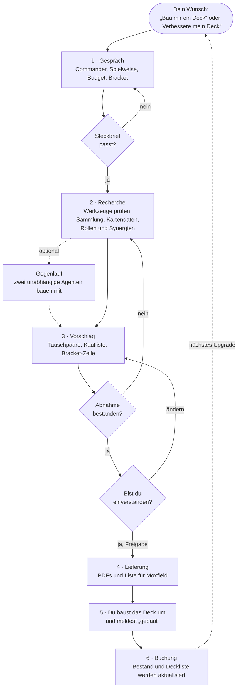

# MTG Commander-Deckbauer & Sammlungsverwalter

**Ein Magic-Assistent für Claude:** Er baut und verbessert Commander-Decks aus deinen eigenen Karten, führt deine Sammlung und beantwortet Regelfragen – auf Deutsch, mit Preisen in Euro und mit fertigen PDFs zum Ausdrucken.

Stand **V1.7** (29.10.2026) · Sprache Deutsch · Lizenz MIT · Privatprojekt

> **Privatprojekt – aber zum Nachbauen gedacht.** Ich habe dieses Projekt für meine eigene Sammlung und meine Spielgruppe gebaut. Es ist kein fertiges Produkt und es gibt keinen Support. Trotzdem darf es jeder nutzen, kopieren und verändern, um sich damit seinen eigenen Deckbau- und Sammlungs-Agenten zu bauen. Deine Daten bleiben dabei in deinem Claude-Konto – in diesem Repo liegen nur Anleitungen und Werkzeuge.

---

## Inhalt

1. [Worum geht es?](#worum-geht-es)
2. [Was du am Ende bekommst](#was-du-am-ende-bekommst)
3. [So läuft ein Deckbau oder Upgrade](#so-läuft-ein-deckbau-oder-upgrade)
4. [Was die Werkzeuge machen](#was-die-werkzeuge-machen)
5. [Installation](#installation)
6. [Plugin oder Projekt? Vor- und Nachteile](#plugin-oder-projekt-vor--und-nachteile)
7. [Wann lohnt sich ein eigenes Repo?](#wann-lohnt-sich-ein-eigenes-repo)
8. [Kleines Wörterbuch](#kleines-wörterbuch)
9. [Aufbau des Repos](#aufbau-des-repos)
10. [Anleitungen von Anthropic und GitHub](#anleitungen-von-anthropic-und-github)
11. [Datenquellen, Hinweise, Lizenz](#datenquellen-hinweise-lizenz)

---

## Worum geht es?

Wer Commander spielt, kennt das Problem: Die Sammlung wächst, die Decks sollen besser werden – aber welche Karten hast du eigentlich noch frei? Welche Karte im Deck ist die schwächste? Lohnt sich ein Kauf, oder liegt etwas Gleichwertiges schon in der Kiste? Und ist das Deck danach noch fair für deine Runde?

Dieses Projekt bringt Claude bei, diese Fragen **wie ein erfahrener Mitspieler mit Taschenrechner** zu beantworten:

- **Deine Karten zuerst.** Claude kennt deine Sammlung und schlägt zuerst Karten vor, die du schon besitzt und die in keinem Deck stecken. Gekauft wird nur, wenn es sich lohnt – mit Preis, günstigerer Alternative und einer Einschätzung, ob der Kauf sein Geld wert ist.
- **Fair bleiben.** Jedes Deck wird gegen die offiziellen Commander-Brackets geprüft (Standard: Bracket 3). Claude sagt dir offen, wenn ein Vorschlag die Grenze überschreitet.
- **Belegen statt raten.** Kartentexte, Preise und Statistiken kommen aus echten Daten (Scryfall, EDHREC, Commander Spellbook), nicht aus dem Gedächtnis. Was Einschätzung ist, wird als Einschätzung gekennzeichnet.
- **Du entscheidest.** Claude fragt, schlägt vor und begründet. Erst wenn du zustimmst und das Deck wirklich umgebaut hast, wird etwas im Bestand eingetragen.

Das **Ziel**: bessere, verlässlichere Decks aus dem, was du schon hast – mit möglichst wenig Geld und ohne die Runde zu überfahren.

## Was du am Ende bekommst

| Ergebnis | Wozu |
|---|---|
| **Vorschlag mit Tauschpaaren** | Welche Karte raus, welche rein – jeweils mit Begründung aus dem Kartentext und dem Hinweis, ob die neue Karte schon frei in deiner Sammlung liegt |
| **Bracket-Zeile und Abnahme** | Ein Satz zur Stärkestufe und eine Prüfliste, ob das Deck „fertig“ ist: genug Mana, Kartenvorteil, Interaktion, Siegwege, stabile Starthände |
| **Kaufliste** | Nur was fehlt, mit Preis in Euro (Cardmarket), günstigerer Alternative und Klasse A–D (A = Kernkarte, D = Geldfalle) |
| **PDFs mit Kartenbildern** | Deck-PDF (ganzes Deck mit Manakurve), Tauschübersicht (welche Karte du aus welcher Box holst), Fazit (alle Änderungen erklärt) |
| **Liste für Moxfield** | Zum Einfügen in Moxfield oder ein anderes Deck-Programm |
| **Sammlungsüberblick und Verkaufsliste** | Was du hast, was frei ist, was kein Deck braucht und verkauft werden kann |
| **Regelantworten** | Mit Regelnummer aus den offiziellen Comprehensive Rules |

So sieht ein Ausschnitt aus einem Vorschlag aus (gekürztes Beispiel):

| Raus → Rein | Rolle | Warum | Status |
|---|---|---|---|
| Release the Dogs → Grasp of Fate | Interaktion | 4 Mana nur für Spielsteine → 3 Mana, entfernt bei jedem Gegner eine bleibende Karte | frei in der Sammlung |

> Bracket 3 – 2/3 Game Changer – keine Massen-Landzerstörung, keine Extra-Züge in Serie, keine frühe 2-Karten-Combo.

## So läuft ein Deckbau oder Upgrade



1. **Gespräch:** Claude fragt nur, was es wirklich wissen muss – mit einer Empfehlung zu jeder Frage und der Antwort „Weiß nicht – entscheide du“. Am Ende steht ein kurzer Steckbrief, den du bestätigst.
2. **Recherche:** Die Werkzeuge rechnen: Was ist frei? Welche Rollen fehlen? Welche Karten passen zum Commander? Hier wird nicht gespart.
3. **Vorschlag und Abnahme:** Claude prüft den eigenen Vorschlag gegen eine feste Liste. Fällt er durch, wird nachgebessert, bevor du ihn siehst. Danach passt du an, so oft du willst.
4. **Lieferung:** Nach deinem Ja gibt es auf Wunsch die PDFs und die Liste für Moxfield.
5. **Umbau:** Du baust das Deck mit echten Karten um.
6. **Buchung:** Erst jetzt trägt Claude die Änderung ein. So stimmt der Bestand immer mit deinem Tisch überein.

## Was die Werkzeuge machen

Claude bekommt in jedem Gespräch einen kleinen Rechner mit Python. Dort laufen die Werkzeuge – du musst nichts davon selbst bedienen.

| Werkzeug | Was es macht | Was du davon hast |
|---|---|---|
| **Kartendatenbank** | Lädt alle Kartendaten und Preise, liest deine Sammlung und Decks, prüft neue Scans auf Doppelte | Du weißt jederzeit, was du hast und was frei ist |
| **Deckbau-Assistent** | Sucht Kandidaten, bildet Tauschpaare, prüft Qualität und Bracket, erstellt die Verkaufsliste | Vorschläge, die auf deiner Sammlung beruhen |
| **Bewertung** | Ein einheitliches Regelwerk: Welche Karte erfüllt welche Rolle? Wie gut passt sie zum Commander? Lohnt der Kauf? | Gleiche Maßstäbe für jedes Deck |
| **Simulation** | Spielt die ersten Züge eines Decks tausendfach durch (Starthand, Länder, Commander pünktlich?) | Du siehst, ob das Deck verlässlich startet |
| **Archetypen** | Richtwerte aus tausenden Durchschnittsdecks je Spielweise (Tokens, Landfall, Aristokraten …) | Lücken fallen auf, bevor sie im Spiel wehtun |
| **PDF-Ersteller** | Deck-PDF, Tauschübersicht, Fazit und Verkaufsliste mit Kartenbildern | Etwas zum Ausdrucken oder fürs Handy |
| **Protokoll, Pakete, Zugang** | Nur im Projekt: Änderungsprotokoll, Datentransport, Passwort und Rollen | Nachvollziehbar, was wann geändert wurde |

## Installation

### Was du brauchst

- Ein **Claude-Konto** auf [claude.ai](https://claude.ai) (ich nutze Pro; Skills gibt es laut Anthropic auch im kostenlosen Abo).
- In den Einstellungen unter **Capabilities**: **Code-Ausführung** („Code execution and file creation“ bzw. „Create and edit files“) und **Netzwerkzugriff** („Allow network egress“) einschalten – die Werkzeuge laden Kartendaten aus dem Internet. [Anleitung von Anthropic](https://support.claude.com/en/articles/12111783)
- Deine Sammlung als **CSV-Export** aus Moxfield oder ManaBox und deine Decks als Textliste.

### Der Installationsbefehl

Dieses Repo ist ein **Plugin-Marketplace** – du musst nichts herunterladen.

**In claude.ai oder der Desktop-App:**

1. [claude.ai/customize/plugins](https://claude.ai/customize/plugins) öffnen.
2. **Add → Add marketplace** wählen und eingeben:

   ```text
   Aperol96/mtg-werkzeuge
   ```

3. Beim Plugin **MTG Commander-Deckbauer** auf **Add** tippen. Fertig – der Skill steht dir jetzt in jedem Chat zur Verfügung, auch auf dem Handy.
4. Tipp: Beim Marketplace **Sync automatically** einschalten, dann kommen neue Versionen von selbst.

**In Claude Code** (Terminal):

```text
/plugin install mtg-commander-deckbauer --marketplace Aperol96/mtg-werkzeuge
```

**Ohne Marketplace:** Auf GitHub **Code → Download ZIP** wählen und die ZIP-Datei unter [Customize → Plugins](https://claude.ai/customize/plugins) mit **Add → Upload plugin** hochladen. Dann kommen Updates aber nicht automatisch.

### Loslegen

Öffne einen neuen Chat, lade deinen Sammlungs-Export hoch und schreib zum Beispiel:

> Hier ist meine Sammlung. Verbessere mein Deck „Mardu Surge“ für Bracket 3, nur mit Karten, die ich schon habe.

Claude erkennt die Aufgabe, lädt den Skill und führt dich durch den Ablauf oben.

### Als Projekt einrichten (für Fortgeschrittene)

Ein **Claude-Projekt** merkt sich deine Sammlung dauerhaft und kennt Rollen (Admin, User, Gast). Am einfachsten geht die Einrichtung mit dem installierten Plugin: Schreib in einem Chat **„Richte mir den MTG-Deckbauer als Projekt ein“**. Claude fragt nach einem Passwort und gibt dir eine ZIP-Datei zum Hochladen und den Text für die Projektanweisungen. Danach:

1. [Neues Projekt anlegen](https://support.claude.com/en/articles/9519177-how-can-i-create-and-manage-projects) (Desktop-App oder Browser – Projektanweisungen lassen sich in der Handy-App nicht bearbeiten).
2. Den Text in die **Projektanweisungen** einfügen und die Dateien aus der ZIP hochladen.
3. Einen neuen Chat im Projekt öffnen und mit **„Admin \<dein Passwort\>“** anmelden. Claude richtet dann deinen Bestand ein.

Von Hand geht es auch: Die Dateien liegen in [`skills/mtg-commander-deckbauer/projekt/`](skills/mtg-commander-deckbauer/projekt/), die Anweisungen in `Projektanweisungen.md`, dazu gehört `werkzeugkiste.txt`. Die Passwort-Datei `zugang.json` legt Claude mit dem Werkzeug `zugang.py` an.

## Plugin oder Projekt? Vor- und Nachteile

| | **Plugin (Skill)** | **Projekt** |
|---|---|---|
| **Einrichtung** | eine Eingabe, rund eine Minute | Dateien hochladen, Text kopieren, Passwort anlegen – rund eine Viertelstunde |
| **Sammlung merken** | nein – du lädst deinen Export in jedem Chat hoch und nimmst geänderte Dateien wieder mit | ja – Claude bucht Käufe, Verkäufe und Umbauten direkt ins Projekt |
| **Rollen** | keine | Admin (Passwort), User, Gast mit eigener Sammlung und PIN-Archiv |
| **Wo nutzbar** | in jedem Chat, in der Desktop-App, auf dem Handy, in Cowork und Claude Code | nur in diesem Projekt (Browser, Desktop-App, Handy) |
| **Updates** | kommen aus diesem Repo – mit „Sync automatically“ von selbst | von Hand: neue Dateien hochladen, Anweisungen ersetzen |
| **Verbrauch** | lädt nur, wenn du nach Magic fragst | die Projektanweisungen (rund 10.000 Zeichen) laufen in jedem Chat des Projekts mit |
| **Passt für** | Ausprobieren, gelegentliche Upgrades, ein einzelnes Deck | regelmäßiges Bauen, gepflegte Sammlung, Gäste in der Spielgruppe |

**Meine Empfehlung:** Mit dem Plugin anfangen. Wer merkt, dass er die Sammlung nicht jedes Mal hochladen will, richtet danach das Projekt ein – das Plugin hilft dabei.

## Wann lohnt sich ein eigenes Repo?

**Zum Nutzen brauchst du kein eigenes Repo.** Installiere das Plugin und fertig.

Eine eigene Kopie auf GitHub (ein **Fork**) lohnt sich, wenn du …

- **Regeln oder Werkzeuge ändern** willst, zum Beispiel ein anderes Standard-Bracket, eine andere Währung, eigene Spielweisen oder eine andere Sortierung deiner Kartenboxen;
- **eine feste Version** behalten willst, die sich nicht mit jedem Update hier ändert;
- **deine Fassung mit Freunden teilen** willst – sie fügen dann deinen Fork als Marketplace hinzu (`<dein-name>/mtg-werkzeuge`);
- **Verbesserungen zurückgeben** möchtest (als Pull Request).

So geht’s: Oben rechts auf **Fork** klicken ([Anleitung von GitHub](https://docs.github.com/de/pull-requests/collaborating-with-pull-requests/working-with-forks/fork-a-repo)), Dateien in deinem Fork ändern und in claude.ai deinen Fork statt `Aperol96/mtg-werkzeuge` als Marketplace eintragen. Für ein privates Repo verbindest du dabei dein GitHub-Konto mit Claude ([Anleitung von Anthropic](https://claude.com/docs/plugins/overview)).

> **Wichtig:** Lege nie deine Sammlung, Decklisten oder die Passwort-Datei in ein öffentliches Repo. Die gehören in dein Claude-Projekt.

## Kleines Wörterbuch

| Begriff | Bedeutung |
|---|---|
| **Commander** | Magic-Format mit 100 Karten, jede nur einmal, eine legendäre Kreatur als Anführer |
| **Bracket** | offizielle Stärkestufe 1–5 für Commander-Decks; 3 ist „aufgerüstet, aber fair“ |
| **Game Changer** | Karten auf einer offiziellen Liste besonders starker Karten; in Bracket 3 höchstens drei |
| **Freie Karten** | Karten, die du besitzt und die in keinem Deck stecken oder für eine Idee reserviert sind |
| **Moxfield / ManaBox** | beliebte Programme für Decklisten und zum Scannen von Karten |
| **Scryfall / EDHREC / Commander Spellbook** | Kartendatenbank mit Preisen · Statistiken aus Millionen Decklisten · Combo-Datenbank |
| **Skill** | eine Anleitung mit Dateien, die Claude lädt, wenn eine Aufgabe dazu passt |
| **Plugin / Marketplace** | ein Paket aus Skills · ein Repo, aus dem man Plugins installiert |
| **Projekt** | ein Arbeitsbereich in claude.ai mit festen Anweisungen und eigenen Dateien |
| **Repo** | ein Ordner mit Versionsgeschichte auf GitHub – wie dieser hier |

## Aufbau des Repos

| Ordner/Datei | Inhalt |
|---|---|
| `.claude-plugin/` | macht das Repo zum Plugin und zum Marketplace (`plugin.json`, `marketplace.json`) |
| `skills/mtg-commander-deckbauer/SKILL.md` | Einstieg: Wann Claude den Skill nutzt und wie es vorgeht |
| `skills/mtg-commander-deckbauer/projekt/` | die Methodik: Deckbau-Verfahren, Werkzeug-Handbuch, Quellen, Regeln, Archetypen, Rollen – und die Projektanweisungen |
| `skills/mtg-commander-deckbauer/werkzeuge/` | die Python-Werkzeuge |
| `skills/mtg-commander-deckbauer/werkzeugkiste.txt` | alle Werkzeuge als ein geprüftes Paket für Claude-Projekte |
| `tests/` | automatische Tests (laufen bei jeder Änderung auf GitHub) |

Mein eigenes Projekt lädt die Werkzeuge von einem festen, geprüften Stand dieses Repos.

<details>
<summary><b>Für Bastler: die Werkzeuge ohne Claude nutzen</b></summary>

Python 3 genügt; für PDFs zusätzlich `pip install pillow reportlab`. Jedes Werkzeug erklärt sich mit `--help`, das Handbuch steht in [`projekt/05_Datenbank-und-Tools.md`](skills/mtg-commander-deckbauer/projekt/05_Datenbank-und-Tools.md).

```bash
cd skills/mtg-commander-deckbauer/werkzeuge
python3 mtg_db.py build --sammlung meine_sammlung.csv --decks mein_deck.txt
python3 deckbau.py upgrade mein_deck.txt --stufe 0
```

Tests: `pip install pytest && python -m pytest tests -q` (ohne Netz) · `python tests/rauchtest.py` (prüft, ob die Datenquellen erreichbar sind).

</details>

## Anleitungen von Anthropic und GitHub

- **Plugins in claude.ai, Desktop-App und Cowork:** [Plugins](https://claude.com/docs/plugins/overview) · [Was in welcher App funktioniert](https://claude.com/docs/plugins/platform-support)
- **Skills:** [Skills in Claude nutzen](https://support.claude.com/en/articles/12512180-use-skills-in-claude) · [Eigene Skills erstellen](https://claude.com/docs/skills/how-to)
- **Projekte:** [Was sind Projekte?](https://support.claude.com/en/articles/9517075-what-are-projects) · [Projekte anlegen und verwalten](https://support.claude.com/en/articles/9519177-how-can-i-create-and-manage-projects)
- **Code-Ausführung und Netzwerk:** [Create and edit files with Claude](https://support.claude.com/en/articles/12111783)
- **Claude Code:** [Plugins installieren](https://code.claude.com/docs/en/plugins/install) · [Skills](https://code.claude.com/docs/en/skills)
- **GitHub:** [Ein Repository forken](https://docs.github.com/de/pull-requests/collaborating-with-pull-requests/working-with-forks/fork-a-repo)

Menünamen ändern sich mit der Zeit – im Zweifel gilt die Anleitung von Anthropic.

## Datenquellen, Hinweise, Lizenz

- **Welche Daten das Plugin sendet:** Kartennamen an Scryfall, EDHREC und Commander Spellbook, um Kartentexte, Preise, Statistiken und Combos abzufragen. Deine Sammlung bleibt in deinem Claude-Konto. Bitte beachte die Nutzungsbedingungen dieser Dienste.
- **Gegenlauf:** nutzt die Methodik von [Commander Deck Skills](https://github.com/philiptyler/mtg-commander-deck-claude-skills) und [MTG Master](https://github.com/M-Sahin/mtg-master) (beide MIT); deren Code wird weder mitgeliefert noch ausgeführt.
- **Schriften der PDFs:** Cinzel und EB Garamond (SIL Open Font License).
- **Lizenz:** MIT. Magic: The Gathering ist eine Marke von Wizards of the Coast. Dies ist ein inoffizielles Fanprojekt ohne Verbindung zu Wizards of the Coast.

---

<sub>**English summary:** A private, German-language Claude add-on for Magic: The Gathering Commander. It builds and upgrades decks from cards you already own, keeps track of your collection (Moxfield/ManaBox), checks every deck against Bracket 3, weighs cost against benefit in EUR and renders PDFs with card images. Install it in claude.ai under Customize → Plugins → Add marketplace with `Aperol96/mtg-werkzeuge`, or in Claude Code with `/plugin install mtg-commander-deckbauer --marketplace Aperol96/mtg-werkzeuge`. Free to use and adapt under the MIT license.</sub>
