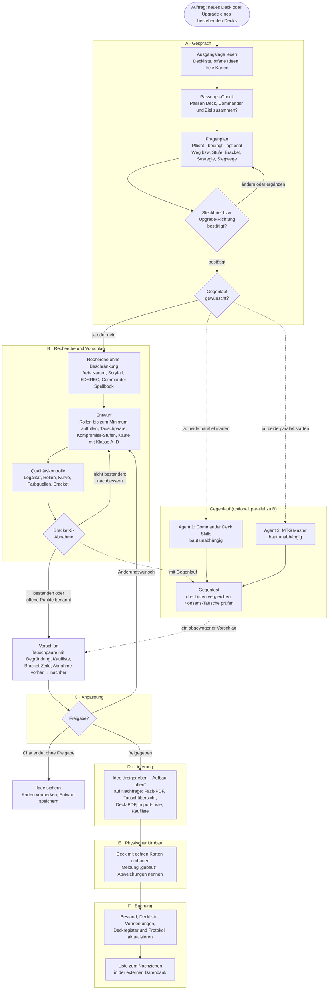

# MTG Commander-Deckbauer & Sammlungsverwalter

**Ein Magic-Assistent für Claude:** Er baut und upgradet Commander-Decks aus deinen eigenen Karten, führt deinen Bestand und beantwortet Regelfragen – auf Deutsch, mit Preisen in Euro (Cardmarket) und mit fertigen PDFs.

Stand **V1.7.1** (29.10.2026) · Sprache Deutsch · Lizenz MIT · Privatprojekt · Aufwand bisher: 5 Arbeitstage (25.–29.10.2026), davon gemessen 2,5 h · 315 Mio. Token · ≈ 117 € API-Gegenwert ([Details](#aufwand-und-kosten))

> **Privatprojekt – aber zum Nachbauen gedacht.** Ich habe dieses Projekt für meine eigene Sammlung und meine Spielgruppe gebaut. Es ist kein fertiges Produkt und es gibt keinen Support. Trotzdem darf es jeder nutzen, kopieren und verändern, um sich damit seinen eigenen Deckbau- und Sammlungs-Agenten zu bauen. Deine Daten bleiben dabei in deinem Claude-Konto – in diesem Repo liegen nur Anleitungen und Werkzeuge.

**Für wen:** Für Spieler, die Commander kennen. Magic-Begriffe (Ramp, Removal, Board Wipe, Game Changer, Bracket …) werden hier nicht erklärt – erklärt wird, was an diesem Projekt neu ist: die Begriffe des Projekts und alles rund um Claude, Skills und GitHub.

---

## Inhalt

1. [Worum geht es?](#worum-geht-es)
2. [Was du am Ende bekommst](#was-du-am-ende-bekommst)
3. [Bestand, Sammlung, freie Karten](#bestand-sammlung-freie-karten)
4. [Deine Daten und deine externe Datenbank](#deine-daten-und-deine-externe-datenbank)
5. [So läuft ein Deckbau oder Upgrade](#so-läuft-ein-deckbau-oder-upgrade)
6. [Wege, Stufen und Klassen](#wege-stufen-und-klassen)
7. [Die Abnahme: wann ein Deck fertig ist](#die-abnahme-wann-ein-deck-fertig-ist)
8. [Der Gegenlauf: zwei fremde Agenten bauen mit](#der-gegenlauf-zwei-fremde-agenten-bauen-mit)
9. [Die Verkaufsliste](#die-verkaufsliste)
10. [Was die Werkzeuge machen](#was-die-werkzeuge-machen)
11. [Aufwand und Kosten](#aufwand-und-kosten)
12. [Installation](#installation)
13. [Plugin oder Projekt? Vor- und Nachteile](#plugin-oder-projekt-vor--und-nachteile)
14. [Wann lohnt sich ein eigenes Repo?](#wann-lohnt-sich-ein-eigenes-repo)
15. [Wörterbuch](#wörterbuch)
16. [Aufbau des Repos](#aufbau-des-repos)
17. [Anleitungen von Anthropic und GitHub](#anleitungen-von-anthropic-und-github)
18. [Datenquellen, Hinweise, Lizenz](#datenquellen-hinweise-lizenz)

---

## Worum geht es?

Die Sammlung wächst, die Decks sollen besser werden – aber welche Karten liegen eigentlich noch frei herum? Welche Karte im Deck ist die schwächste? Lohnt sich ein Kauf, oder liegt etwas Gleichwertiges schon in der Box? Und ist das Deck danach noch Bracket 3 oder schon drüber?

Dieses Projekt bringt Claude bei, diese Fragen **wie ein erfahrener Mitspieler mit Taschenrechner** zu beantworten:

- **Deine Karten zuerst.** Claude kennt deinen Bestand und plant zuerst freie Karten ein. Gekauft wird nur, wenn es sich lohnt – mit Preis, günstigerer Alternative und einer Klasse A–D.
- **Bracket-treu.** Jedes Deck wird gegen die offiziellen Brackets geprüft (Standard: Bracket 3) – im Bracket so stark wie möglich, aber nicht heimlich darüber. Das Ziel-Bracket wird bei jedem Bau und Upgrade gefragt (auf Wunsch mit Erklärung aller Brackets); bleibt das Ziel das heutige Bracket des Decks, warnt der **Bracket-Wächter** bei jeder Änderung, die es verschieben würde, und schlägt eine Karte vor, die im Bracket bleibt.
- **Belegen statt raten.** Oracle-Texte, Preise und Statistiken kommen aus Scryfall, EDHREC und Commander Spellbook, nicht aus dem Gedächtnis. EDHREC ist dabei nur ein Anhaltspunkt: Eine Karte, die dort beim Commander fehlt, ist unbekannt – nicht schwach.
- **Du entscheidest.** Claude fragt, schlägt vor und begründet. Erst wenn du freigibst und das Deck wirklich umgebaut hast, wird etwas gebucht.

Das **Ziel**: bessere, konsistentere Decks aus dem, was du schon hast – mit möglichst wenig Geld und ohne die Runde zu überfahren.

## Was du am Ende bekommst

| Ergebnis | Wozu |
|---|---|
| **Vorschlag mit Tauschpaaren** | Welche Karte raus, welche rein – je mit „warum raus“ und „warum rein“ aus dem Oracle-Text und dem Hinweis, ob die neue Karte frei in deiner Sammlung liegt |
| **Bracket-Zeile und Abnahme** | Ein Satz zum Bracket und eine Prüfliste mit acht Punkten, ob das Deck fertig ist ([Abnahme](#die-abnahme-wann-ein-deck-fertig-ist)) |
| **Kaufliste** | Nur was fehlt: Rolle, Preis in Euro (günstigster Druck auf Cardmarket, mit Datum), günstigere Alternative und [Klasse A–D](#klassen-a-bis-d-lohnt-sich-ein-kauf) |
| **PDFs mit Kartenbildern** | Deck-PDF (ganzes Deck mit Manakurve), Tauschübersicht (welche Karte du aus welcher Box holst), Einkaufsliste (Sammelbestellung), Fazit (alle Änderungen erklärt) – auch als kleinere Handy-Variante; in Tausch-, Einkaufs- und Verkaufsliste hakst du jede Karte im PDF-Reader per Klick ab |
| **Import-Liste für deine externe Datenbank** | Deckliste zum Einfügen und neue Karten als CSV – für das Programm, in dem du Decks und Sammlung außerhalb von Claude pflegst ([mehr dazu](#deine-daten-und-deine-externe-datenbank)) |
| **Verkaufsliste mit PDF** | Welche Sammlungskarten du verkaufen kannst, welche Bedenken es gibt und welche du behalten solltest ([Verkaufsliste](#die-verkaufsliste)) |
| **Regelantworten** | Ergebnis in einem Satz, dann die Regelnummern aus den Comprehensive Rules |

So sieht ein Ausschnitt aus einem Vorschlag aus (gekürztes Beispiel):

| Raus → Rein | Rolle | Warum | Status |
|---|---|---|---|
| Release the Dogs → Grasp of Fate | Removal | 4 Mana für vier 1/1-Tokens → 3 Mana, exiliert bei jedem Gegner ein Nonland-Permanent, solange die Enchantment liegt | frei in der Sammlung |

> Bracket 3 – 2/3 Game Changer – keine MLD, keine Extra-Turn-Ketten, keine frühe 2-Karten-Combo.

## Bestand, Sammlung, freie Karten

Drei Begriffe tragen das ganze Projekt. Sie bauen aufeinander auf:

```text
Bestand       = Deckkarten + Sammlung        alles, was du besitzt
Sammlung      = Bestand − Deckkarten         Karten, die in keinem Deck stecken
freie Karten  = Sammlung − vorgemerkte       nur diese plant Claude ein
```

- **Bestand:** alle Karten, die du besitzt – egal ob im Deck oder in der Box. Er besteht aus deinem ersten Import (der *Basis*) plus allen *Buchungen* danach (Käufe, Verkäufe, Scans, Tausche).
- **Deckkarten:** Karten, die gerade in einem Deck stecken (Commander, Mainboard, Sideboard; das Maybeboard zählt nicht).
- **Sammlung:** der Rest – Karten in keinem Deck.
- **Vorgemerkt:** Karten der Sammlung, die eine noch nicht umgesetzte Deck-Idee für sich reserviert hat. So verplant kein anderer Chat dieselbe Karte.
- **Freie Karten:** Sammlung ohne vorgemerkte Karten. **Nur sie zählen beim Deckbau als vorhanden.**

**Beispiel:** Du besitzt 4× Sol Ring, 3 stecken in Decks → Sammlung 1. Hat eine Idee diesen einen für sich vorgemerkt → frei 0. Claude schlägt ihn dann für kein anderes Deck vor.

Dazu drei Regeln:

- **Verkaufte Karten** werden als Abgang gebucht und verlassen den Bestand. Eine nur *geplante* Verkaufsliste (`V-nnn`) reserviert nichts: Die Karten bleiben frei, sind aber markiert, damit sie nicht aus Versehen in ein Deck wandern.
- **Deckkarten** nimmt Claude nur per Tausch aus einem anderen Deck – und nur mit Ersatz, damit das abgebende Deck seine 100 Karten behält.
- **Basic Lands** werden selten vollständig gescannt. Deshalb prüft Claude bei jedem Deck, ob genug da sind, und schlägt fehlende getrennt zum Nachkauf vor.

## Deine Daten und deine externe Datenbank

- **Hauptdatenbank** ist dort, wo Claude bucht: im Projekt die Projektdateien, mit dem Plugin die Dateien, die du mitbringst und am Ende wieder mitnimmst. Jede Änderung ist eine Buchung mit Beleg.
- **Externe Datenbank** ist das Programm, in dem du Decks und Sammlung außerhalb von Claude pflegst. **Die Wahl liegt bei dir.** Ich nutze Moxfield; ManaBox liefert bei mir nur die Scans. Die Richtung ist immer **Claude → externe Datenbank**: Claude bucht und gibt dir danach eine Liste zum Nachziehen. Änderungen, die du nur in der externen Datenbank machst, kennt Claude nicht – außer du lädst einen neuen Export hoch.

| | Getestet | Sonst |
|---|---|---|
| **Sammlung einlesen** | CSV-Export aus Moxfield (direkt) und ManaBox (wird umgewandelt) | andere CSV-Dateien (z. B. Spellbinder) über die Spaltennamen bzw. Kartennamen; passt das schlecht, fragt Claude nach einem Moxfield- oder ManaBox-Export |
| **Decks einlesen** | Textlisten aus Moxfield und ManaBox, MTGO-/Arena-Varianten (`1x Name`, `(SET) 123`, `Commander (1)` …), Deck-CSV aus ManaBox | – |
| **Ausgeben** | Deckliste als Einfügeblock (`1 Kartenname`, Commander nach einer Leerzeile am Ende) und Zugänge als CSV im Moxfield-Format | Den Einfügeblock lesen viele Deck-Programme, getestet ist er nur mit Moxfield. Im Projekt stellst du deine externe Datenbank im Nutzerprofil ein. |

## So läuft ein Deckbau oder Upgrade

Der Ablauf hat sechs Stufen (A–F). Ins Projekt geschrieben wird nur in D (Idee sichern) und F (Buchung).



1. **A · Gespräch:** Claude liest zuerst, was es schon weiß (Deckliste, offene Ideen, freie Karten), und prüft bei bestehenden Decks die **Passung**: Trägt der Commander das Ziel, oder passt ein anderer Commander aus Deck, Sammlung oder als günstiger Kauf deutlich besser? Dann der **Fragenplan** – keine feste Zahl an Fragen, sondern Pflichtfragen, bedingte und optionale Fragen, jede mit Empfehlung und „Weiß nicht – entscheide du“. Am Ende bestätigst du den **Steckbrief** (neues Deck) bzw. die **Upgrade-Richtung**, und Claude fragt einmal nach dem [Gegenlauf](#der-gegenlauf-zwei-fremde-agenten-bauen-mit).
2. **B · Recherche und Vorschlag:** Die Recherche bekommt alle Ressourcen, die sie braucht. Die Werkzeuge füllen Ramp, Card Draw, Removal, Board Wipes, Protection und Lands bis zum Minimum des Archetyps auf – auch wenn du sie nicht erwähnst –, bilden Tauschpaare und nehmen nichts Tragendes heraus (Raus-Sperren). Fällt der Entwurf durch die [Abnahme](#die-abnahme-wann-ein-deck-fertig-ist), bessert Claude nach, bevor du ihn siehst.
3. **C · Anpassung:** Du änderst, so oft du willst; jede Runde zeigt nur die Änderungen. Endet der Chat ohne Freigabe, wird der Stand als **Idee** gesichert und die Karten werden vorgemerkt.
4. **D · Lieferung:** Nach deiner Freigabe fragt Claude kurz, ob du PDFs und die Import-Liste willst.
5. **E · Physischer Umbau:** Du baust das Deck mit echten Karten um und meldest „gebaut“ – mit Abweichungen, falls eine Karte fehlte oder ein Kauf noch unterwegs ist.
6. **F · Buchung:** Erst jetzt bucht Claude. So stimmt der Bestand mit deinem Tisch überein. Danach bekommst du die Liste für deine externe Datenbank.

Ohne Projekt (nur Plugin) gibt es keinen dauerhaften Speicher: Claude gibt dir in D bzw. F die geänderten Dateien (Buchungen, Decklisten) zum Aufheben mit.

## Wege, Stufen und Klassen

Drei Begriffe regeln, **wie viel Geld** in ein Deck fließt. Sie werden gern verwechselt:

| Begriff | Frage dahinter | Gilt für |
|---|---|---|
| **Weg 1 / Weg 2** | Nur eigene Karten – oder auch kaufen? | neue Decks |
| **Stufe 0, 1, 2 …** | Wie viel Budget bekommt das Upgrade? | Upgrades (und das Budget in Weg 2) |
| **Klasse A–D** | Lohnt sich *diese eine* Kaufkarte? | jede Karte auf der Kaufliste |

Dazu kommt die **Kompromiss-Stufe** – trotz des Namens keine Budgetstufe, sondern die Einstufung einer freien Ersatzkarte (siehe unten).

### Weg 1 und Weg 2 (neue Decks)

| Weg | Was gebaut wird | Wann sinnvoll |
|---|---|---|
| **Weg 1** | ausschließlich aus freien Karten, 0 € | Du willst sehen, was deine Sammlung hergibt |
| **Weg 2** | freie Karten zuerst, dazu gezielte Käufe – nur wo sie Strategie, Combos, Game-Changer-Slots oder Lücken deutlich verbessern; Budget bis 25 €, 50 €, 100 € oder offen | Die Strategie soll voll umgesetzt werden |

Für Weg 1 gibt es vorher die **Machbarkeitsampel**: Reichen die freien Karten für ein spielbares Deck? *Plan-Karten* sind freie Karten mit Bezug zum Commander (Oracle-Bezug ≥ 0,33 oder EDHREC-Synergie ≥ 10 %).

| Ampel | Regel | Folge |
|---|---|---|
| **GRÜN** | Lands, Ramp, Card Draw, Single-Target- und Mass-Removal erreichen das Minimum, ≥ 25 Plan-Karten | bauen |
| **GELB** | alle Kernrollen ≥ 50 % des Minimums, ≥ 12 Plan-Karten | bauen, Abstriche offen benennen |
| **ROT** | eine Kernrolle < 50 % oder < 12 Plan-Karten | nicht bauen; Claude nennt die Lücken und fragt, ob gezielt Käufe gesucht werden sollen (→ Weg 2) – oder schlägt einen anderen Commander vor |

### Stufen (Upgrades)

Ein Upgrade wird in **Budgetstufen** angeboten, damit du siehst, was jeder Euro bringt:

| Stufe | Inhalt |
|---|---|
| **Stufe 0** | nur freie Karten aus der Sammlung, 0 € – Kompromisse sind hier normal |
| **Stufe 1, 2, 3 …** | mit steigendem Budget (z. B. bis 25 €, bis 50 €); die Beträge richten sich nach deinem Budget |

Zu jeder Stufe gibt es die Summe und einen Satz, was sie bewirkt. Die Reihenfolge folgt dem Grenznutzen – die ersten rund zehn Tausche bringen am meisten: Manabasis-Fehler beheben → Removal und Card Draw auf den Richtwert → Synergie-Payoffs → Luxus.

**Rückfall vor Kauf und Kompromiss-Stufe:** Fehlt einer Rolle das Minimum, sucht Claude zuerst eine freie Karte mit dieser Rolle – auch eine schwächere – und stellt ihr die beste Kauf-Alternative gegenüber. Die freie Karte bekommt eine **Kompromiss-Stufe**:

| Kompromiss-Stufe | Bedeutung |
|---|---|
| **gleichwertig** | erfüllt die Rolle fast so gut wie die Kauf-Alternative |
| **funktional, aber langsamer** | erfüllt die Rolle, aber teurer im Mana, mit Sorcery-Speed oder nur einmal |
| **nur Platzhalter** | füllt den Slot, bis gekauft wird |

Daneben steht ein Satz, was der Aufpreis bringt, z. B. „Pitiless Plunderer für 2,92 € bringt: Wert 0,62 → 1,05“. Du entscheidest.

### Klassen A bis D: Lohnt sich ein Kauf?

Jede Karte auf der Kaufliste bekommt eine Klasse. Die Werkzeuge rechnen sie aus Daten vor, Claude prüft sie am Oracle-Text und darf begründet abweichen.

| Klasse | Bedeutung | Empfehlung |
|---|---|---|
| **A – Kern** | hohe Wirkung, kein gleichwertiger günstiger Ersatz | kaufen |
| **B – effizient** | gute Wirkung pro Euro | kaufen |
| **C – Luxus** | kleine Verbesserung für viel Geld | nur bei Restbudget oder wenn die Karte in mehreren Decks läuft |
| **D – Falle** | teuer und im Bracket kaum besser – oder bracket-schädlich, z. B. der 4. Game Changer in Bracket 3 | nicht kaufen |

**So rechnen die Werkzeuge:**

1. **Wert der Karte für diesen Commander** (0 bis über 1): der größere von zwei Werten – EDHREC (Inclusion + 1,5 × Synergy beim Commander) oder Oracle-Bezug (wie gut der Kartentext zu dem passt, was der Commander erzeugt und nutzt; zählt auch für Karten, die auf EDHREC fehlen).
2. **Wirkung 1–5** aus dem Wert: unter 0,10 → 1 · unter 0,25 → 2 · unter 0,45 → 3 · unter 0,70 → 4 · sonst 5. **+1**, wenn die Karte eine Rolle füllt, die unter dem Minimum liegt.
3. **Klasse:**
   - **D**, wenn die Karte bracket-schädlich ist oder Wirkung ≤ 2 bei einem Preis ab 5 € hat;
   - sonst **A**, wenn Wirkung ≥ 4 und es keine günstigere Karte mit rund 80 % der Wirkung gibt;
   - sonst **B**, wenn sie höchstens 2 € je Wirkungspunkt über 1 kostet: Preis ÷ (Wirkung − 1) ≤ 2 €;
   - sonst **C**.

*Rechenbeispiel:* Wirkung 4, Preis 5 € → 5 € ÷ 3 = 1,67 € je Punkt → **B** (gibt es keinen 80-%-Ersatz, wird es **A**). Wirkung 2, Preis 6 € → **D**.

## Die Abnahme: wann ein Deck fertig ist

Ein Deck – neu oder nach einem Upgrade – gilt erst als fertig, wenn es die **Bracket-3-Abnahme** besteht. Sie prüft acht Punkte:

| # | Prüfpunkt | bestanden, wenn … |
|---|---|---|
| 1 | legal | 100 Karten, Singleton, Color Identity, Banlist |
| 2 | harte Bracket-Grenzen | ≤ 3 Game Changer, keine MLD, keine Extra-Turn-Ketten; 2-Karten-Combos prüft Claude darauf, ob sie früh gewinnen |
| 3 | Rollen | jede Kernrolle (Lands, Ramp, Card Draw, Removal, Board Wipes, Protection) ≥ Minimum des Archetyps |
| 4 | Interaktion nach Ziel | Removal für Creatures ≥ 5, Artifacts ≥ 2, Enchantments ≥ 2, Graveyard ≥ 1 |
| 5 | Siegwege | mindestens zwei, mit konkreten Karten |
| 6 | Kernpakete | jedes Paket des Archetyps ≥ 80 % des EDHREC-Medians |
| 7 | Konsistenz | Simulation der ersten Züge: Starthand, Lands, Commander pünktlich |
| 8 | messbar stärker | Stärke-Index über dem Ausgangsstand (nur bei Upgrades) |

Urteil: **bestanden · bedingt** (offene Punkte brauchen eine Einschätzung) **· nicht bestanden**. „Nicht bestanden“ heißt nicht „nicht liefern“: Claude nennt die offenen Punkte und was sie lösen würde (Kauf mit Klasse oder Kompromiss aus der Sammlung). Symmetrische Creature-Wipes zählen im Go-wide-Deck (Tokens, Aristocrats, Tribal, Counters, Voltron, Blink) nicht als Wipe, weil sie den eigenen Plan zerstören.

## Der Gegenlauf: zwei fremde Agenten bauen mit

**Was:** Auf Wunsch bauen zwei unabhängige Agenten dasselbe Deck bzw. dasselbe Upgrade – mit denselben Vorgaben (Ziel, Stufe, Budget, Bracket, freie Karten), aber nach der Methodik zweier anderer, öffentlicher Claude-Skills. Claude legt danach **drei Vorschläge** nebeneinander und macht daraus **einen**.

**Wozu:** Jedes Verfahren hat blinde Flecken. Der Gegenlauf zeigt, wo das Projekt Karten, Pläne oder Raus-Gründe übersieht – und umgekehrt, wo die anderen danebenliegen. Was die Konkurrenz wiederholt besser macht, fließt als Verbesserung in die Werkzeuge ein.

| Agent | Vorbild (MIT-Lizenz) | Methodik |
|---|---|---|
| **Commander Deck Skills** | [philiptyler/mtg-commander-deck-claude-skills](https://github.com/philiptyler/mtg-commander-deck-claude-skills) | Review → schwächste Karten → Combos vervollständigen → Kandidaten je Lücke → Manabasis mit hypergeometrischen Wahrscheinlichkeiten; bewusst ohne EDHREC |
| **MTG Master** | [M-Sahin/mtg-master](https://github.com/M-Sahin/mtg-master) | „verify, don't recall“: Rolle des Commanders und Synergiepaket → Template-Abgleich → Manabasis → Bracket → Tauschliste; EDHREC als Anhaltspunkt |

**So läuft er ab:**

1. **Frage:** Am Ende des Gesprächs (Stufe A) fragt Claude einmal mit Ja/Nein – mit Hinweis auf den Aufwand.
2. **Vorbereiten:** Das Werkzeug legt je Agent einen Auftrag an: Ausgangsdeck, Liste der freien Karten, deine Vorgaben. Die Anleitungen der beiden Skills werden auf einem festen, geprüften Stand geholt.
3. **Bauen:** Beide Agenten laufen parallel im Hintergrund, während Claude den eigenen Vorschlag erarbeitet. Sie sehen weder die Werkzeuge noch die Dokumente dieses Projekts noch die Ergebnisse der anderen. Fremder Code wird nicht ausgeführt – die Agenten folgen der beschriebenen Methodik und holen sich ihre Daten selbst (Scryfall, Commander Spellbook, ggf. EDHREC).
4. **Gegentest:** Ein Werkzeug vergleicht die drei Listen: Abnahme je Punkt, Kennzahlen, Überschneidung – und welche Tausche mehrere Läufe unabhängig gewählt haben (**Konsens**) und welche nur einer.
5. **Abwägen:** Konsens-Tausche prüft Claude am Oracle-Text und Spielplan und übernimmt sie, wenn sie halten; Einzelvorschläge der anderen prüft es gegen Raus-Sperren, Rollen-Minima, Bracket, Kurve und Manabasis. Raus-Gründe der Konkurrenz werden nie ungeprüft übernommen. Ergebnis: ein Vorschlag mit einer kurzen Tabelle „was von wem kam und warum“.

**Aufwand:** je Agent rund 0,2–0,3 Mio. Token, 5–15 Minuten (beide parallel), API-Gegenwert rund 4–6 € je Agent – im Abo zählt das aufs Nutzungslimit. Gebucht wird aus dem Gegenlauf nichts.

## Die Verkaufsliste

Ein eigenes Feature, unabhängig vom Deckbau: Claude prüft, welche Karten deiner **Sammlung** (alles, was nicht in einem Deck steckt) du verkaufen kannst, und macht daraus eine Liste und ein PDF.

**Was geprüft wird:** jedes Sammlungs-Exemplar ab einem Mindestpreis (Standard 1 €) gegen **alle** deine Decks – Commander-Decks und 60-Karten-Decks. Auch Karten, die du für eine Deck-Idee vorgemerkt hast, sind dabei; sie sind markiert und stehen immer mindestens in Kat. 2.

| Gruppe | Wann | Beispiel für die Begründung |
|---|---|---|
| **Kat. 3 – nicht verkaufen** | passt exakt zu einem deiner Commander-Decks: auf EDHREC in mindestens jedem dritten Deck dieses Commanders und deutlich häufiger als im Farbschnitt – oder der Oracle-Text bedient den Plan des Decks direkt (je Deck ein Exemplar) | „Passt genau zum Plan von Deck X: belohnt viele Spielsteine und bringt Vorteil beim Eintreten. Nachkaufen kostet heute ab 8,23 € (günstigster Druck).“ |
| **Kat. 2 – Verkauf möglich, mit Bedenken** | passt zu einem Deck, ist aber kein Muss · füllt eine Rolle unter Minimum · Game Changer · Playset-Ergänzung für ein 60-Karten-Deck · ⚑ zusammen mit einem Deck gescannt · für eine Idee vorgemerkt | „Wird auf EDHREC in etwa jedem sechsten Deck mit diesem Commander gespielt, dort etwa so oft wie im Farbschnitt – ein Allrounder, kein Muss.“ · „Deck X hat zu wenig Ramp (8 statt mindestens 10) – die Karte könnte die Lücke füllen.“ |
| **Kat. 1 – ohne Bedenken verkaufen** | alles andere | – |

Die Begründungen sind ganze Sätze ohne Indexwerte: Anteile als „etwa jedem dritten Deck“, Lücken mit Ist- und Soll-Zahl, Kat. 3 mit dem Nachkaufpreis.

**Was du bekommst:**

- **im Chat:** die drei Gruppen mit Anzahl und Summe, je Karte Name, Druck (Set und Nummer), Sprache, Preis und Begründung;
- **als Datei:** die Verkaufsliste (Kat. 1–3) als Text;
- **als PDF:** Kopf mit Anzahl und Summe je Kategorie und der verkäuflichen Summe (Kat. 1+2), dann die Abschnitte Kat. 1, Kat. 2 und Kat. 3, je Karte das Box-Etikett (wo sie in deiner Ablage liegt), Druck, Sprache, Preis und die Begründung; am Ende alle Begründungen von Kat. 2 und 3 ungekürzt zum Abhaken. Sortiert nach deiner Ablage, damit du die Karten Box für Box ziehen kannst; dazu je Seite ein PNG und auf Wunsch eine Handy-Variante.

**Preise:** dein eigener Druck, Cardmarket-Preis über Scryfall mit Datum. Deutsche Exemplare stehen zum Preis der englischen Version – auf Cardmarket liegen sie meist etwas darunter; Gebühren und Versand gehen ab.

**Im Projekt** kannst du die Liste als **geplanten Verkauf** (`V-nnn`) sichern: Die Karten bleiben frei, sind aber markiert – die Werkzeuge warnen, wenn ein Deckvorschlag eine davon nutzen will. Erst wenn du den Verkauf meldest, wird gebucht.

## Was die Werkzeuge machen

Claude bekommt in jedem Gespräch einen kleinen Rechner mit Python. Dort laufen die Werkzeuge – du musst nichts davon selbst bedienen.

| Werkzeug | Was es macht | Was du davon hast |
|---|---|---|
| **Kartendatenbank** (`mtg_db.py`) | Lädt Kartendaten und Preise, liest Bestand und Decks, prüft neue Scans auf Doppelte, rechnet aus, was frei ist | Du weißt jederzeit, was du hast und was frei ist |
| **Deckbau-Assistent** (`deckbau.py`) | Passung, Kandidaten, Tauschpaare, Qualitätskontrolle, Abnahme, Gegenlauf, Verkaufsprüfung | Vorschläge, die auf deinem Bestand beruhen |
| **Bewertung** (`bewertung.py`) | ein Regelwerk für alle: Rollen, Wert, Oracle-Bezug, Kompromiss-Stufen, Klassen A–D | gleiche Maßstäbe für jedes Deck |
| **Simulation** (`simulation.py`) | spielt die ersten Züge eines Decks tausendfach durch | Du siehst, ob das Deck verlässlich startet |
| **Archetypen** (`archetypen.py`) | Richtwerte je Archetyp aus den EDHREC-Durchschnittsdecks (Tokens, Landfall, Aristocrats …) | Lücken fallen auf, bevor sie im Spiel wehtun |
| **PDF-Ersteller** (`kartenbilder.py`) | Deck-PDF, Tauschübersicht, Einkaufsliste, Fazit und Verkaufsliste mit Kartenbildern; Listen mit anklickbaren Kästchen zum Abhaken | Etwas zum Ausdrucken oder fürs Handy |
| **Protokoll, Pakete, Zugang** (`protokoll.py`, `paket.py`, `zugang.py`) | nur im Projekt: Änderungsprotokoll, Datentransport, Passwort und Rollen | Nachvollziehbar, was wann geändert wurde |

## Aufwand und Kosten

Das Projekt ist an **sieben Arbeitstagen vom 25. bis 31.10.2026** entstanden – von der ersten Datenbank bis zu dieser README.

| Tag | Was entstanden ist | gemessen |
|---|---|---|
| 25.10.2026 | Kartendatenbank, Import der Sammlung, geführter Deckbau | – |
| 26.10.2026 | Buchungen mit Beleg, Decklisten als Soll-Stand, Scan-Import mit Doppelscan-Schutz, Vormerkungen | – |
| 27.10.2026 | Archetypen, PDFs mit Kartenbildern, Weitergabe-Paket, Upgrade-Modus, Werkzeuge auf GitHub | – |
| 28.10.2026 | Rollen und Anmeldung (Admin, User, Gast) | – |
| 29.10.2026 | Verkaufsliste, externes Review umgesetzt (Bewertung, Abnahme, Simulation), Gegentests, Gegenlauf, Plugin und README | 2,5 h · 315 Mio. Token · ≈ 117 € |
| 30.10.2026 | Einkaufsliste-PDF, Abhak-Kästchen, neue EDHREC-Richtwerte, Verkaufsliste mit Bedenken; Weitergabe nur noch über dieses Repo | – |
| 31.10.2026 | V1.9: Ziel-Bracket im Fragenplan, Ausgangsbracket, Bracket-Wächter (`deckbau.py bracket`) | – |

- **Gemessen** wird erst seit dem 29.10.2026, und nur in Sitzungen mit lesbarem Protokoll (Werkzeug- und GitHub-Arbeit). Die Chats der ersten Tage in claude.ai lassen sich nicht auswerten – der tatsächliche Aufwand liegt also höher.
- **API-Gegenwert** heißt: So viel hätte dieselbe Nutzung über die Anthropic-API zu Listenpreisen gekostet (umgerechnet mit rund 1,15 USD je Euro). Den größten Teil der Token macht das günstige Cache-Lesen aus, weil jede Antwort den ganzen Gesprächsstand neu liest.
- **Tatsächlich bezahlt** habe ich nur mein Claude-Abo (Pro); die Nutzung zählt dort aufs Nutzungslimit, nicht auf eine Rechnung.

## Installation

### Was du brauchst

- Ein **Claude-Konto** auf [claude.ai](https://claude.ai) (ich nutze Pro; Skills gibt es laut Anthropic auch im kostenlosen Abo).
- In den Einstellungen unter **Capabilities**: **Code-Ausführung** („Code execution and file creation“ bzw. „Create and edit files“) und **Netzwerkzugriff** („Allow network egress“) einschalten – die Werkzeuge laden Kartendaten aus dem Internet. [Anleitung von Anthropic](https://support.claude.com/en/articles/12111783)
- Deine Sammlung als **CSV-Export** aus deinem Sammlungsprogramm (getestet: Moxfield, ManaBox) und deine Decks als Textliste ([Formate](#deine-daten-und-deine-externe-datenbank)).

### Der Installationsbefehl

Dieses Repo ist ein **Plugin-Marketplace** – du musst nichts herunterladen.

**In claude.ai oder der Desktop-App:**

1. [claude.ai/customize/plugins](https://claude.ai/customize/plugins) öffnen.
2. **Add → Add marketplace** wählen und eingeben:

   ```text
   Aperol96/mtg-werkzeuge
   ```

3. Beim Plugin **MTG Commander-Deckbauer** auf **Add** tippen. Fertig – der Skill steht dir jetzt in jedem Chat zur Verfügung, auch auf dem Handy.
4. Tipp: Beim Marketplace **Sync automatically** einschalten, dann kommen neue Versionen von selbst.

**In Claude Code** (Terminal):

```text
/plugin install mtg-commander-deckbauer --marketplace Aperol96/mtg-werkzeuge
```

**Ohne Marketplace:** Auf GitHub **Code → Download ZIP** wählen und die ZIP-Datei unter [Customize → Plugins](https://claude.ai/customize/plugins) mit **Add → Upload plugin** hochladen. Dann kommen Updates aber nicht automatisch.

### Loslegen

Öffne einen neuen Chat, lade deinen Sammlungs-Export und die Deckliste hoch und schreib zum Beispiel:

> Hier sind meine Sammlung und mein Deck. Upgrade es für Bracket 3 in Stufe 0, also nur mit freien Karten.

Claude erkennt die Aufgabe, lädt den Skill und führt dich durch den [Ablauf](#so-läuft-ein-deckbau-oder-upgrade).

### Als Projekt einrichten (für Fortgeschrittene)

Ein **Claude-Projekt** merkt sich deinen Bestand dauerhaft und kennt Rollen (Admin, User, Gast). Am einfachsten geht die Einrichtung mit dem installierten Plugin: Schreib in einem Chat **„Richte mir den MTG-Deckbauer als Projekt ein“**. Claude fragt nach einem Passwort und gibt dir eine ZIP-Datei zum Hochladen und den Text für die Projektanweisungen. Danach:

1. [Neues Projekt anlegen](https://support.claude.com/en/articles/9519177-how-can-i-create-and-manage-projects) (Desktop-App oder Browser – Projektanweisungen lassen sich in der Handy-App nicht bearbeiten).
2. Den Text in die **Projektanweisungen** einfügen und die Dateien aus der ZIP hochladen.
3. Einen neuen Chat im Projekt öffnen und mit **„Admin \<dein Passwort\>“** anmelden. Claude richtet dann deinen Bestand ein und legt ein Nutzerprofil an – dort steht unter anderem, welches Programm deine externe Datenbank ist (Vorgabe: Moxfield); ändern kannst du das jederzeit im Chat.

Von Hand geht es auch: Die Dateien liegen in [`skills/mtg-commander-deckbauer/projekt/`](skills/mtg-commander-deckbauer/projekt/), die Anweisungen in `Projektanweisungen.md`, dazu gehört `werkzeugkiste.txt`. Die Passwort-Datei `zugang.json` legt Claude mit dem Werkzeug `zugang.py` an.

## Plugin oder Projekt? Vor- und Nachteile

| | **Plugin (Skill)** | **Projekt** |
|---|---|---|
| **Einrichtung** | eine Eingabe, rund eine Minute | Dateien hochladen, Text kopieren, Passwort anlegen – rund eine Viertelstunde |
| **Bestand merken** | nein – du lädst deine Dateien in jedem Chat hoch und nimmst geänderte Dateien wieder mit | ja – Claude bucht Käufe, Verkäufe und Umbauten direkt ins Projekt |
| **Ideen und Vormerkungen** | nur im laufenden Chat | über alle Chats hinweg, mit einer gemeinsamen Kaufliste |
| **Rollen** | keine | Admin (Passwort), User, Gast mit eigener Sammlung und PIN-Archiv |
| **Wo nutzbar** | in jedem Chat, in der Desktop-App, auf dem Handy, in Cowork und Claude Code | nur in diesem Projekt (Browser, Desktop-App, Handy) |
| **Updates** | kommen aus diesem Repo – mit „Sync automatically“ von selbst | von Hand: neue Dateien hochladen, Anweisungen ersetzen |
| **Verbrauch** | lädt nur, wenn du nach Magic fragst | die Projektanweisungen (rund 10.000 Zeichen) laufen in jedem Chat des Projekts mit |
| **Passt für** | Ausprobieren, gelegentliche Upgrades, ein einzelnes Deck | regelmäßiges Bauen, gepflegter Bestand, Gäste in der Spielgruppe |

**Meine Empfehlung:** Mit dem Plugin anfangen. Wer merkt, dass er die Sammlung nicht jedes Mal hochladen will, richtet danach das Projekt ein – das Plugin hilft dabei.

## Wann lohnt sich ein eigenes Repo?

**Zum Nutzen brauchst du kein eigenes Repo.** Installiere das Plugin und fertig.

Eine eigene Kopie auf GitHub (ein **Fork**) lohnt sich, wenn du …

- **Regeln oder Werkzeuge ändern** willst, zum Beispiel ein anderes Standard-Bracket, eine andere Währung, eigene Archetypen oder eine andere Ablage deiner Boxen;
- **eine feste Version** behalten willst, die sich nicht mit jedem Update hier ändert;
- **deine Fassung mit Freunden teilen** willst – sie fügen dann deinen Fork als Marketplace hinzu (`<dein-name>/mtg-werkzeuge`);
- **Verbesserungen zurückgeben** möchtest (als Pull Request).

So geht’s: Oben rechts auf **Fork** klicken ([Anleitung von GitHub](https://docs.github.com/de/pull-requests/collaborating-with-pull-requests/working-with-forks/fork-a-repo)), Dateien in deinem Fork ändern und in claude.ai deinen Fork statt `Aperol96/mtg-werkzeuge` als Marketplace eintragen. Für ein privates Repo verbindest du dabei dein GitHub-Konto mit Claude ([Anleitung von Anthropic](https://claude.com/docs/plugins/overview)).

> **Wichtig:** Lege nie deine Sammlung, Decklisten oder die Passwort-Datei in ein öffentliches Repo. Die gehören in dein Claude-Projekt.

## Wörterbuch

Nur Begriffe dieses Projekts und rund um Claude und GitHub – Magic-Begriffe setzt das Projekt voraus.

**Bestand und Daten**

| Begriff | Bedeutung |
|---|---|
| **Bestand · Deckkarten · Sammlung · freie Karten** | siehe [oben](#bestand-sammlung-freie-karten): Bestand = Deckkarten + Sammlung; freie Karten = Sammlung − vorgemerkte Karten |
| **vorgemerkt** | von einer noch nicht umgesetzten Idee reserviert – nicht frei |
| **Basis · Buchung · Beleg** | Basis = dein erster Import; jede Änderung danach ist eine Buchung (Kauf, Verkauf, Scan, Tausch) mit Beleg |
| **Soll-Stand** | die maßgebliche Deckliste bei Claude – nicht die in deiner externen Datenbank |
| **externe Datenbank** | dein Programm außerhalb von Claude (bei mir Moxfield); bekommt Änderungen als Import-Liste |
| **Einfügeblock · Import-Liste** | Deckliste `1 Kartenname` je Zeile, alphabetisch, Commander nach einer Leerzeile am Ende, ohne Überschriften |
| **Ablage · Box-Etikett** | wo eine Karte physisch liegt (Standard: nach Farbe, darin eine Box je Kartentyp) |
| **⚑** | freie Karte, die zur selben Zeit wie ein Deck gescannt wurde – liegt vielleicht beim Deck; vor Einbau oder Verkauf nachsehen |

**Deckbau**

| Begriff | Bedeutung |
|---|---|
| **Idee · Freigabe · „gebaut“** | Idee = Vorschlag ohne Freigabe, gesichert mit Vormerkungen · Freigabe = dein Ja · „gebaut“ = deine Meldung nach dem Umbau; erst dann wird gebucht |
| **Fragenplan** | Fragen vor dem Bau: Pflicht, bedingt, optional – jede mit Empfehlung und „Weiß nicht – entscheide du“ |
| **Passung** | Prüfung, ob Deck, Commander und Ziel zusammenpassen oder ein anderer Commander besser trägt |
| **Steckbrief · Upgrade-Richtung** | Zusammenfassung zum Bestätigen vor dem Bau: Commander, Plan, Bracket, Weg bzw. Stufe, Siegwege |
| **Weg 1 / Weg 2 · Machbarkeitsampel** | neue Decks nur aus freien Karten bzw. mit gezielten Käufen · Ampel, ob Weg 1 reicht ([Details](#weg-1-und-weg-2-neue-decks)) |
| **Stufe 0, 1, 2 …** | Budgetstufen für Upgrades; Stufe 0 = nur freie Karten ([Details](#stufen-upgrades)) |
| **Kompromiss-Stufe** | Einstufung einer freien Ersatzkarte: gleichwertig · funktional, aber langsamer · nur Platzhalter |
| **Klasse A–D** | Kosten-Nutzen einer Kaufkarte: Kern · effizient · Luxus · Falle ([Details](#klassen-a-bis-d-lohnt-sich-ein-kauf)) |
| **Rollen · Minimum · Richtwert** | Aufgaben im Deck (Lands, Ramp, Card Draw, Removal, Board Wipes, Protection) mit Mindestzahl je Archetyp |
| **Kernpaket** | die Bausteine eines Archetyps (Engine, Enabler, Payoff), gemessen am Median der EDHREC-Durchschnittsdecks |
| **Wert · Oracle-Bezug** | Wert = wie gut eine Karte zu diesem Commander passt (EDHREC oder Kartentext) · Oracle-Bezug = derselbe Abgleich nur über den Kartentext, 0–1 |
| **Raus-Sperre** | Karten, die nicht raus dürfen: Ein Kernpaket fiele unter den Median, die Karte hat starken Commander-Bezug (≥ 0,5), oder ihre Rolle bzw. das Removal gegen ein Ziel fiele unter das Minimum |
| **Tauschpaar** | „raus → rein“, je mit Begründung aus dem Oracle-Text und Preisunterschied |
| **Bracket-Zeile** | das Ergebnis des Bracket-Checks in einer Zeile |
| **Ausgangsbracket · Ziel-Bracket · Bracket-Wächter** | Bracket, in dem das Deck heute steht · Bracket, das es erreichen soll · Warnung, wenn eine Änderung das Deck ungewollt in ein anderes Bracket schiebt (`deckbau.py bracket`) |
| **Abnahme · Stärke-Index** | acht Prüfpunkte, ab wann ein Deck fertig ist · Vergleichszahl zwischen zwei Ständen desselben Decks ([Details](#die-abnahme-wann-ein-deck-fertig-ist)) |
| **Gegenlauf · Gegentest** | zwei fremde Agenten bauen mit · Vergleich der drei Listen ([Details](#der-gegenlauf-zwei-fremde-agenten-bauen-mit)) |
| **Fazit-PDF · Tauschübersicht · Deck-PDF** | Änderungen mit Begründung · Pickliste „was aus welcher Box“ · ganzes Deck mit Kurzdaten |
| **Verkaufsliste · Kat. 1 / 2 / 3 · V-nnn** | Sammlungskarten ohne Bedenken, mit Bedenken, nicht verkaufen · gesicherter, geplanter Verkauf ([Details](#die-verkaufsliste)) |

**Rollen im Projekt**

| Begriff | Bedeutung |
|---|---|
| **Admin** | Besitzer des Projekts, meldet sich mit Passwort an; darf alles, auch Regeln und Werkzeuge ändern |
| **User** | arbeitet mit dem Bestand des Projekts und bucht; Regeln und Werkzeuge bleiben gesperrt |
| **Gast** | bringt seine eigene Sammlung mit; die wird nie Teil des Projekt-Bestands und am Ende archiviert (mit PIN) oder gelöscht |

**Claude und GitHub**

| Begriff | Bedeutung |
|---|---|
| **Skill** | eine Anleitung mit Dateien, die Claude von selbst lädt, wenn eine Aufgabe dazu passt |
| **Plugin · Marketplace** | ein Paket aus Skills · ein Repo, aus dem man Plugins installiert |
| **Projekt** | ein Arbeitsbereich in claude.ai mit festen Anweisungen und eigenen Dateien |
| **Projektanweisungen** | der feste Text, den Claude in jedem Chat eines Projekts mitliest |
| **Agent · Unteragent** | eine weitere Claude-Instanz, die eine Teilaufgabe unabhängig erledigt (hier: der Gegenlauf) |
| **Repo · Fork · Pull Request** | Ordner mit Versionsgeschichte auf GitHub · deine eigene Kopie davon · Vorschlag, eine Änderung zurückzugeben |

## Aufbau des Repos

| Ordner/Datei | Inhalt |
|---|---|
| `.claude-plugin/` | macht das Repo zum Plugin und zum Marketplace (`plugin.json`, `marketplace.json`) |
| `.github/workflows/` | startet die Tests bei jeder Änderung und einmal im Monat einen Test gegen die echten Datenquellen |
| `skills/mtg-commander-deckbauer/SKILL.md` | Einstieg: wann Claude den Skill nutzt und wie es vorgeht |
| `skills/mtg-commander-deckbauer/projekt/` | die Methodik: Deckbau-Verfahren, Werkzeug-Handbuch, Quellen, Regeln, Archetypen, Rollen – und die Projektanweisungen |
| `skills/mtg-commander-deckbauer/werkzeuge/` | die Python-Werkzeuge |
| `skills/mtg-commander-deckbauer/werkzeugkiste.txt` | alle Werkzeuge als ein geprüftes Paket für Claude-Projekte |
| `tests/` | automatische Tests mit einem Testdeck und kleinen Auszügen aus Scryfall und EDHREC |

Mein eigenes Projekt lädt die Werkzeuge von einem festen, geprüften Stand dieses Repos.

<details>
<summary><b>Für Bastler: die Werkzeuge ohne Claude nutzen</b></summary>

Python 3 genügt; für PDFs zusätzlich `pip install pillow reportlab`. Jedes Werkzeug erklärt sich mit `--help`, das Handbuch steht in [`projekt/05_Datenbank-und-Tools.md`](skills/mtg-commander-deckbauer/projekt/05_Datenbank-und-Tools.md).

```bash
cd skills/mtg-commander-deckbauer/werkzeuge
python3 mtg_db.py build --sammlung meine_sammlung.csv --decks mein_deck.txt
python3 deckbau.py upgrade mein_deck.txt --stufe 0
python3 deckbau.py verkauf --min-preis 1
```

Tests: `pip install pytest && python -m pytest tests -q` (ohne Netz) · `python tests/rauchtest.py` (prüft, ob die Datenquellen erreichbar sind).

</details>

## Anleitungen von Anthropic und GitHub

- **Plugins in claude.ai, Desktop-App und Cowork:** [Plugins](https://claude.com/docs/plugins/overview) · [Was in welcher App funktioniert](https://claude.com/docs/plugins/platform-support)
- **Skills:** [Skills in Claude nutzen](https://support.claude.com/en/articles/12512180-use-skills-in-claude) · [Eigene Skills erstellen](https://claude.com/docs/skills/how-to)
- **Projekte:** [Was sind Projekte?](https://support.claude.com/en/articles/9517075-what-are-projects) · [Projekte anlegen und verwalten](https://support.claude.com/en/articles/9519177-how-can-i-create-and-manage-projects)
- **Code-Ausführung und Netzwerk:** [Create and edit files with Claude](https://support.claude.com/en/articles/12111783)
- **Claude Code:** [Plugins installieren](https://code.claude.com/docs/en/plugins/install) · [Skills](https://code.claude.com/docs/en/skills)
- **GitHub:** [Ein Repository forken](https://docs.github.com/de/pull-requests/collaborating-with-pull-requests/working-with-forks/fork-a-repo)

Menünamen ändern sich mit der Zeit – im Zweifel gilt die Anleitung von Anthropic.

## Datenquellen, Hinweise, Lizenz

- **Welche Daten das Plugin sendet:** Kartennamen an Scryfall, EDHREC und Commander Spellbook, um Oracle-Texte, Preise, Statistiken und Combos abzufragen. Dein Bestand bleibt in deinem Claude-Konto. Bitte beachte die Nutzungsbedingungen dieser Dienste.
- **Gegenlauf:** nutzt die Methodik von [Commander Deck Skills](https://github.com/philiptyler/mtg-commander-deck-claude-skills) und [MTG Master](https://github.com/M-Sahin/mtg-master) (beide MIT); deren Code wird weder mitgeliefert noch ausgeführt.
- **Schriften der PDFs:** Cinzel und EB Garamond (SIL Open Font License).
- **Lizenz:** MIT. Magic: The Gathering ist eine Marke von Wizards of the Coast. Dies ist ein inoffizielles Fanprojekt ohne Verbindung zu Wizards of the Coast.

---

<sub>**English summary:** A private, German-language Claude add-on for Magic: The Gathering Commander. It builds and upgrades decks from cards you already own, keeps track of your collection (import from Moxfield, ManaBox or other CSV exports; your external database is your choice), checks every deck against Bracket 3, weighs cost against benefit in EUR, can run two independent competitor agents for a second opinion, builds a sell list and renders PDFs with card images. Install it in claude.ai under Customize → Plugins → Add marketplace with `Aperol96/mtg-werkzeuge`, or in Claude Code with `/plugin install mtg-commander-deckbauer --marketplace Aperol96/mtg-werkzeuge`. Free to use and adapt under the MIT license.</sub>
