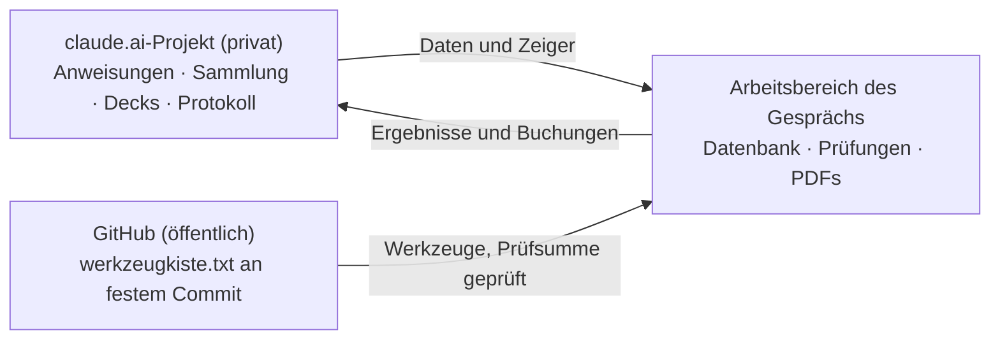

# mtg-werkzeuge

Python-Werkzeuge für **Magic: The Gathering** mit Schwerpunkt **Commander (EDH)**: die eigene Sammlung als Datenbank führen, Decks gegen Richtwerte und Bracket-Regeln prüfen, Upgrades aus der eigenen Sammlung finden und Deck-PDFs mit Kartenbildern erzeugen.

Entstanden sind sie als Werkzeugkasten für einen persönlichen KI-Assistenten (Claude von Anthropic), der damit Decks baut und eine Sammlung verwaltet. Die Skripte laufen aber auch ganz ohne Claude – auf jedem Rechner mit Python.

## Was drin ist

| Datei | Zweck |
|---|---|
| `werkzeuge/mtg_db.py` | baut eine SQLite-Datenbank aus den Scryfall-Kartendaten und der eigenen Sammlung; Besitz und freie Karten, Funktionssuche, Bracket-Prüfung, Import und Export für Moxfield und ManaBox |
| `werkzeuge/deckbau.py` | Commander-Steckbrief, Synergie aus dem Commander-Text (`synergie`), Kandidaten aus der Sammlung, Deckprüfung (Rollen, Kurve, Farbquellen, Bracket, Combos), Upgrade-Vorschläge mit Raus-Sperren und Kompromiss-Stufen, Bracket-3-Abnahme (`abnahme`), Passungs-Check Deck ↔ Commander, Gegentest zweier Decks, Verkaufsprüfung freier Karten |
| `werkzeuge/bewertung.py` | Bewertungsregeln für alle Werkzeuge: Rollen mit Qualitätsregeln, Wert (EDHREC oder Oracle-Bezug), Synergie-Profil des Commanders, Archetyp-Richtwerte, Kompromiss-Stufen, Kosten-Nutzen-Klassen A–D |
| `werkzeuge/simulation.py` | Konsistenz-Simulation der ersten Züge (London-Mulligan, Landdrops, Ramp, Commander pünktlich, Farben) |
| `werkzeuge/protokoll.py` | Änderungsprotokoll, Ideenliste und Deckregister des Projekts lesen und pflegen, ohne die Dateien ganz zu lesen |
| `werkzeuge/archetypen.py` | Kern-Pakete gängiger Commander-Archetypen; welche Archetypen eine Sammlung trägt |
| `werkzeuge/kartenbilder.py` | PDFs mit Kartenbildern: Deck-Übersicht, Tauschliste (Pickliste), Verkaufsliste, Fazit-Bericht |
| `werkzeuge/paket.py` | packt Werkzeuge, Daten oder ein Gast-Archiv in eine prüfsummengesicherte Textdatei und wieder aus |
| `werkzeuge/zugang.py` | Rollen im Projekt (Admin, User, Gast): Passwort und Gast-PIN als PBKDF2-Hash prüfen, Freischaltung, Sitzungsrolle – speichert nie einen Klartext |
| `werkzeuge/archetypen_daten.json` | Richtwerte je Archetyp aus EDHREC-Durchschnittsdecks (Bracket 3) |
| `werkzeuge/projektanweisungen.md` | Projektanweisungen für claude.ai (Quelle; der Admin kopiert sie in die Projekteinstellungen) |
| `tests/` | automatische Tests mit Testdeck und kleinen Scryfall-/EDHREC-Daten (ohne Netz) und ein monatlicher Rauchtest mit Live-Daten (GitHub Actions) |
| `werkzeugkiste.txt` | alle Dateien aus `werkzeuge/` als ein Paket (tar.xz in Base64, mit Prüfsummen) – in dieser Form lädt Claude sie |

Texte und Ausgaben sind auf Deutsch, Preise in Euro (Scryfall, Quelle Cardmarket).

## Warum der Code hier liegt

Claude arbeitet in einem **Projekt auf claude.ai**. Dort liegen die Anweisungen (Regeln und Abläufe) und die Daten. Für jedes Gespräch bekommt Claude einen frischen, leeren Arbeitsbereich (Linux mit Python), der danach wieder verschwindet. Die Werkzeuge müssen also bei jedem Gespräch neu dort hinein.

Früher lagen sie als Textpaket im Projekt und wurden dafür jedes Mal komplett ins Gespräch gelesen – rund 130 KB Text, die bis zum Ende des Gesprächs mitlaufen und das Nutzungskontingent belasten. Jetzt steht im Projekt nur noch ein kleiner Zeiger: ein fester Commit dieses Repos und die SHA-256-Prüfsumme der `werkzeugkiste.txt`. Zu Beginn lädt ein Startbefehl genau diesen Stand herunter, prüft die Prüfsumme und packt aus. Ist GitHub nicht erreichbar oder stimmt die Prüfsumme nicht, nimmt Claude die Kopie aus dem Projekt.

Neue Commits hier ändern im Projekt nichts, bis der Zeiger auf sie umgestellt wird.

## Was im Projekt passiert – und was nicht hier liegt



- **Privat im Projekt:** die Sammlung (Moxfield-Export plus Buchungsjournal), Decklisten, Ideen, das Änderungsprotokoll, die Zugangsdatei mit dem Passwort-Hash und die Archive von Gästen. Davon liegt hier nichts.
- **Im Arbeitsbereich:** Werkzeuge und Daten auspacken, die Datenbank bauen (Scryfall-Kartendaten, rund 110 MB Download), Decks prüfen und verbessern, PDFs erzeugen. Die Ergebnisse schreibt Claude ins Projekt zurück.
- **Nicht in diesem Repo:** alle Daten und das Skript, mit dem Kopien des Projekts für andere entstehen (es enthält persönliche Angaben).

## Rollen im Projekt

Seit Version 1.4 kennt das Projekt vier Zustände: Jeder Chat beginnt im Zustand **Start** (nur Fragen zum Projekt und zu Regeln). Der **Admin** meldet sich mit Passwort an und darf alles, ein **User** arbeitet mit der Sammlung des Projekts, ein **Gast** bringt seine eigene Sammlung als Datei mit und kann sie am Ende unter seinem Namen mit einer PIN archivieren. `zugang.py` prüft Passwort und PIN gegen gespeicherte Hashes, `paket.py` sperrt je Rolle, was sie nicht darf (zum Beispiel bekommt ein Gast nie die Sammlung des Projekts in seinen Arbeitsbereich). Das ist eine Absprache mit dem Assistenten, kein technischer Zugriffsschutz.

## Selbst nutzen – ohne Claude

**Voraussetzungen:** Python 3 (entwickelt und getestet mit Python 3.13) und Internet. Für die PDFs zusätzlich `pip install pillow reportlab`; optional `fonttools` für die Schriften Cinzel und EB Garamond, ohne sie wird DejaVu Serif verwendet.

```bash
git clone https://github.com/Aperol96/mtg-werkzeuge
cd mtg-werkzeuge/werkzeuge

# Datenbank bauen: Sammlung als Moxfield-CSV-Export, Decks als Moxfield-Text
# (Commander nach einer Leerzeile am Ende der Liste)
python3 mtg_db.py build --sammlung meine_sammlung.csv --decks mein_deck.txt

python3 mtg_db.py sammlung                                         # Überblick: Karten, Wert, Farben, Typen
python3 mtg_db.py suche --tag spot-removal --farben W --max-mv 1   # Funktionssuche, eigene Karten zuerst
python3 deckbau.py commander "Atraxa, Praetors' Voice" --bracket 3 # Steckbrief: Oracle-Text, EDHREC-Themen, Combos
python3 deckbau.py pruefen mein_deck.txt --bracket 3               # Rollen, Kurve, Farbquellen, Bracket-Zeile
python3 deckbau.py synergie "Atraxa, Praetors' Voice"            # freie Karten mit Bezug zum Commander-Text
python3 deckbau.py abnahme mein_deck.txt                           # Bracket-3-Abnahme mit Simulation
python3 simulation.py mein_deck.txt --n 10000                      # Mulligans, Landdrops, Commander pünktlich
python3 kartenbilder.py deck mein_deck.txt --out out/mein_deck --mobil   # Deck-PDF mit Kartenbildern
python3 deckbau.py verkauf --min-preis 1                            # freie Karten: verkaufen, mit Hinweis, behalten
python3 kartenbilder.py verkauf out/verkauf.txt --out out/verkauf --mobil # Verkaufsliste mit Kartenbildern
```

- Die Befehle im Ordner `werkzeuge/` ausführen: Dort entsteht die Datenbank `mtg.sqlite`, die `deckbau.py` und `kartenbilder.py` nutzen.
- Jeder Befehl erklärt seine Optionen mit `--help`, zum Beispiel `python3 deckbau.py upgrade --help`.
- ManaBox-Scans zuerst umwandeln: `python3 mtg_db.py manabox-zu-moxfield <scan.csv> --sammlung sammlung.csv`.

## Tests

```bash
pip install pytest
python -m pytest tests -q        # ohne Netz: Testdeck, kleine Scryfall- und EDHREC-Daten in tests/daten/
python tests/rauchtest.py         # mit Netz: Quellen erreichbar, Formate unverändert
```

GitHub Actions führt die Tests bei jedem Push aus und den Rauchtest einmal im Monat. Die Testdaten baut `tests/fixture_bauen.py` aus den vollständigen Scryfall-Bulk-Dateien neu.

## Datenquellen und Hinweise

- Kartendaten, Preise und Bilder kommen von Scryfall, Deckstatistiken von EDHREC, Combos und Bracket-Einschätzungen von Commander Spellbook. Die Werkzeuge rufen sie zur Laufzeit ab – bitte deren Nutzungsbedingungen beachten.
- Die Schriften der PDFs (Cinzel, EB Garamond, SIL Open Font License) werden aus dem Google-Fonts-Repository geladen.
- Magic: The Gathering ist eine Marke von Wizards of the Coast. Dieses Repo ist ein inoffizielles Fanprojekt und steht in keiner Verbindung zu Wizards of the Coast.
